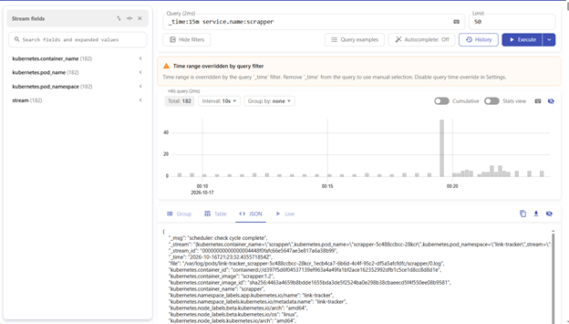
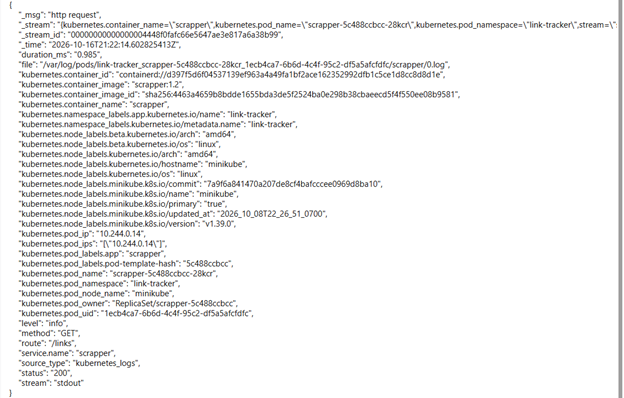
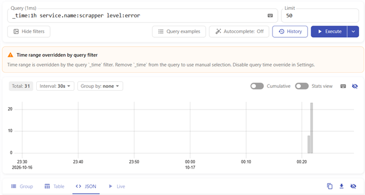
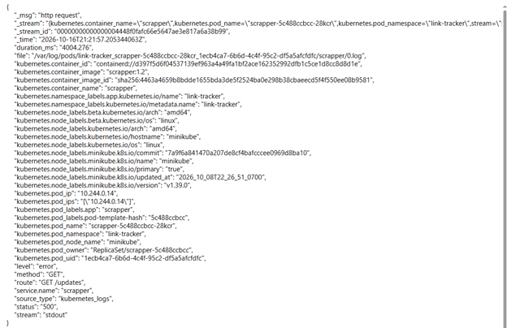
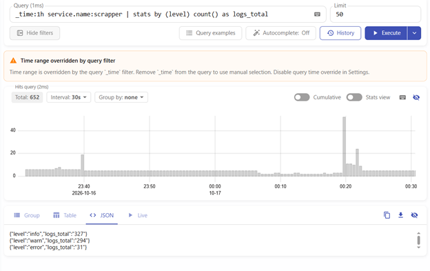
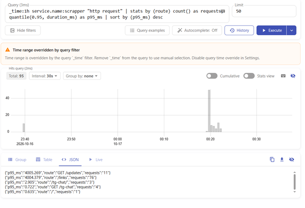

# Отчёт: сбор логов в Victoria Logs

## Что развёрнуто

- **Victoria Logs (single-node)** в namespace `logging`, установлен Helm-чартом `victoria-logs-single`:
  ```
  helm install vls vm/victoria-logs-single -n logging
  ```
- **Vector** в том же namespace, установлен чартом `vector/vector` с конфигом `logging/vector-values.yaml`:
  ```
  helm install vector vector/vector -n logging -f logging/vector-values.yaml
  ```

## Формат логов

Приложение пишет в stdout JSON-логи по одному на событие. Поля: `timestamp`, `level` (`info`/`warn`/`error`), `message`, `service.name` + поля события: `chat_id`, `url`, `err`. Для каждого HTTP-запроса дополнительно пишется запись с полями `method`, `route`, `status`, `duration_ms`; уровень зависит от кода ответа (5xx - `error`, 4xx - `warn`).

## Доставка логов

Vector работает как DaemonSet: по одному поду на узел читает файлы логов контейнеров namespace `link-tracker`, разбирает JSON на отдельные поля, добавляет метаданные Kubernetes (`kubernetes.pod_name`, `kubernetes.container_name`) и отправляет записи в Victoria Logs по Elasticsearch-совместимому протоколу.

Почему так:

- **DaemonSet** - один сборщик на узел вместо одного на каждый под; новые реплики приложения подхватываются автоматически.
- **Приложение не меняется** - оно пишет в stdout, а доставка логов решается на уровне окружения.
- **Vector с явным конфигом** - видно и можно настроить весь путь: фильтр по namespace, разбор JSON, выбор полей сообщения, времени и потока.

## Запросы LogsQL

### 1. Сырые записи за последние 15 минут

```
_time:15m service.name:scrapper
```

Показывает все записи приложения за 15 минут. Видно, что JSON разобран на отдельные поля (`level`, `route`, `status`, `kubernetes.pod_name`).





### 2. Фильтр по полю

```
_time:1h service.name:scrapper level:error
```

Показывает только ошибки: ответы с кодом 500 и сбои планировщика.





### 3. Статистика с группировкой

```
_time:1h service.name:scrapper | stats by (level) count() as logs_total
```

Считает число записей по уровням логирования. Показывает долю `info`, `warn` и `error`.



### 4. Агрегация: перцентиль времени ответа

```
_time:1h service.name:scrapper "http request" | stats by (route) count() as requests, quantile(0.95, duration_ms) as p95_ms | sort by (p95_ms) desc
```

Для каждого маршрута API показывает число запросов и 95-й перцентиль времени ответа в миллисекундах.

